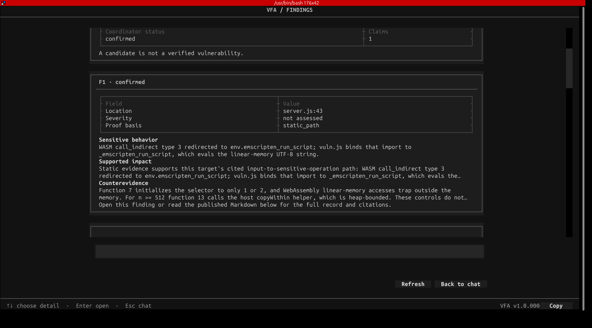
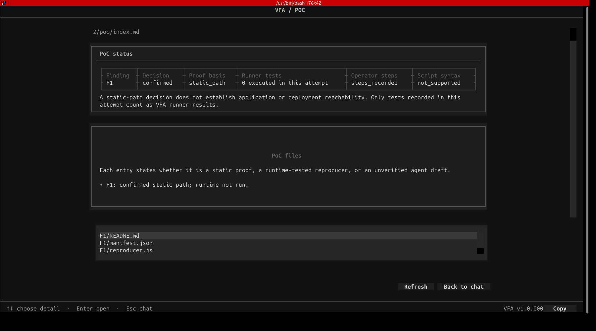

# VFA research dossier

This repository records a selected seven-format case series for Vulnerability Finding Agents (VFA) and a directed evaluation of its Evidence checks. It is an audit archive, not an installation package or a claim that the reported vulnerabilities were exploited. Cite a fixed commit when referring to a particular version of these files. `v1.0.000` is the current CLI UI version; historical run-bound VFA code versions are marked `not recorded` when unavailable.

## Contents

The [method](methodology.md), [target register](targets.csv), [attempt and export register](attempts.csv), and [claim audit](claim-audit.csv) describe the case series. The [selected report summaries](report-scan/) retain case, attempt, and export-revision IDs. [Export provenance](export-provenance.csv) links each summary to the hash of its original private report. The [Evidence-contract study](evidence-contract/) reports directed checker tests. [Figures](figures/) show the architecture and selected case joins. [CLI screenshots](screenshots/) illustrate how one completed case appears to an operator. The two workflow CSVs contain filtered event timelines; their event sequence numbers are pointers into retained records, not public journal entries. Run `python3 verify_dossier.py` to check the published file list and SHA-256 digests in `SHA256SUMS`.

The register contains 9 target-component rows and 319 attempt/export-revision rows representing 147 attempts. Eight selected exports comprise seven primary attempts and one earlier complete ASAR companion. Their 42 Finding entries include 40 from primary exports. The author audit groups the 42 entries into 34 source-to-operation paths. Twenty-six groups contain a conditionally supported static path. By entry, the audit records 26 `supported`, 10 `needs_correction`, and 6 `unresolved` labels. The latest ASAR primary export is partial; the earlier complete companion is a separate attempt with zero verified Findings.

## Reading the results

A VFA `confirmed` Finding is a `static_path` decision under recorded assumptions. The author audit can narrow or regroup that decision. Hash and coordinate checks establish reference integrity, not semantic truth. Every selected PoC has execution state `not_run`; no exploit effect was observed. A PoC marked `draft_only` is a recorded proof-publication state, not the publication status of this dossier.

The report files here are sanitized audit summaries, not byte-identical VFA exports. They omit target bytes, raw Evidence, private case stores and journals, provider transcripts, and original PoC scripts. Two selected UI screenshots are included separately; other captures remain excluded. ASAR and managed DLL local builds are not established as byte-identical to upstream artifacts; see [target provenance](targets.csv). Full scan or checker replay needs excluded inputs. The [license and distribution note](LICENSE.md) covers this repository's original research material and its exclusions.

## Operator view of a saved case

These are unaltered captures of VFA v1.0.000 displaying the **completed** host/WASM case on 7 November 2026. They were not taken while the scan ran. The [screenshot manifest](screenshots/manifest.json) records the case, export revision, capture times, and image hashes. The images illustrate the interface; the registers and audited records above carry the research evidence.

Finding F1 shows the static-path decision and reviewer counterevidence:

The PoC page records that no reproducer was executed in this attempt:

